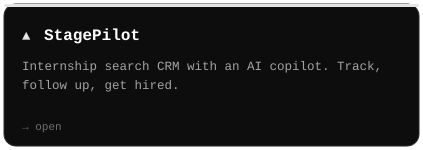
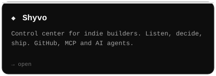
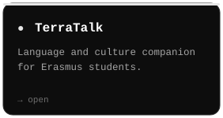
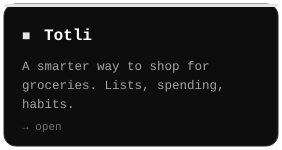
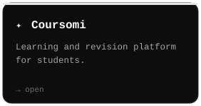

<a href="https://erwanx.com">erwanx.com</a> &nbsp;·&nbsp; <a href="https://shyvo.app">shyvo.app</a> &nbsp;·&nbsp; <a href="https://www.stagepilot.app">stagepilot.app</a> &nbsp;·&nbsp; <a href="https://x.com/ErwanCodes">@ErwanCodes</a> &nbsp;·&nbsp; <a href="mailto:contact@erwanx.com">contact@erwanx.com</a>

Built in Normandy with Claude Code &nbsp;·&nbsp; <a href="https://erwanx.com">erwanx.com</a>

